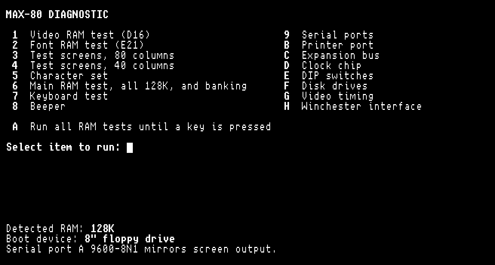

# MAX-80 diagnostics

A diagnostic disk and a machine code monitor for the Lobo MAX-80, a Z80
business computer from 1982. Both are boot disks with no operating
system: the MAX-80's boot ROM loads them from a 5.25" or 8" floppy and
they take over the machine.

- `diag/`: the diagnostic disk. From a menu it tests video RAM, font
  RAM, main RAM and banking, the keyboard, the beeper, the disk drives,
  video timing, the DIP switches, the serial and printer ports, the
  clock chip and the expansion bus, and copies the screen to serial
  port A at 9600 baud.
- `monitor/`: a monitor on its own boot disk, to look at RAM by hand,
  find bad RAM, and load small programs over the serial port: dump,
  edit, fill, move, search, compare, checksum, go, S-records, a RAM
  test and port I/O.
- `xcpmz80/src/`: the MAX-80's I/O addresses (`hw.inc`) and the font
  (`font.bin`, unscii-8, public domain), which both disks build from.
  They come from xcpmz80, a CP/M compatible system for the MAX-80 in
  [lobo_max80](https://github.com/fletto2/lobo_max80).
- `tools/dmk2imd.py`: the IMD disk image writer the disks are made with,
  also from lobo_max80.

## Building

You need sjasmplus and Python 3:

    make -C diag
    make -C monitor

Each writes an 8-inch disk image, `build/diag.imd` or
`build/monitor.imd`, and a 5.25-inch one, `build/diag_525.imd` or
`build/monitor_525.imd`. Write the disk image to a 5.25" or 8" disk and
boot on your MAX-80.

Each folder's `README.md` describes every test and command.

## License

MIT, in each folder's `LICENSE`, `tools/` and `xcpmz80/src/hw.inc` on
the terms in `diag/LICENSE`. The font is unscii-8 by viznut, in the
public domain.
